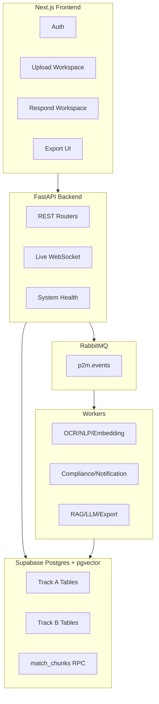
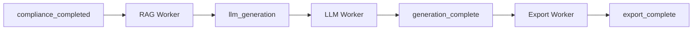

# P2M-TAI — Technical Presentation
### Mi-Parcours (Slide Deck)

**Presenter:** _Your Name_  
**Project:** P2M-TAI  
**Format:** 10 slides

---

## Slide 1 — Project Goal & Scope

### What problem are we solving?
- Teams lose time converting tender documents into compliant, export-ready responses.

### What P2M-TAI delivers
- End-to-end automation from **upload** to **AI-generated response** to **DOCX export**.
- Split into two technical tracks:
  - **Track A:** Ingestion + OCR + NLP + Embedding + Compliance
  - **Track B:** RAG + LLM Generation + Export

**Speaker notes:**
Start with business pain, then explain we built an engineering pipeline that makes tender response generation reliable and repeatable.

---

## Slide 2 — High-Level Architecture

**Speaker notes:**
Highlight that frontend stays simple while backend uses event-driven workers to process heavy AI tasks asynchronously.

---

## Slide 3 — Core Tech Stack

### Frontend
- Next.js (App Router), React, TypeScript strict mode
- Tailwind CSS v4 + shadcn/ui + lucide icons
- Supabase JS client for auth/session

### Backend
- FastAPI + Uvicorn
- Supabase Python client
- RabbitMQ via Pika

### AI & Processing
- OCR: Mistral
- NLP: langdetect + chonkie + deep-translator
- Embeddings: LangChain HuggingFace endpoint (`BAAI/bge-m3`)
- Generation: LangChain Groq (`llama-3.3-70b-versatile`)

### Output & Notifications
- DOCX: python-docx
- Email: SendGrid

**Speaker notes:**
Stress that each dependency has a concrete role in one stage of the pipeline.

---

## Slide 4 — Track A Pipeline (Ingestion to Compliance)

```mermaid
flowchart LR
    U[POST /documents] --> E1[document_uploaded]
    E1 --> O[OCR Worker]
    O --> E2[ocr_complete]
    E2 --> N[NLP Worker]
    N --> E3[nlp_completed]
    E3 --> EM[Embedding Worker]
    EM --> E4[embedding_complete]
    E4 --> C[Compliance Engine]
    C --> E5[compliance_completed]
    E5 --> NO[Notification Worker]
```

### Outcome of Track A
- Structured chunks + metadata + vectors
- Compliance report + recommendation + requirements matrix
- Notification event for high match

**Speaker notes:**
Track A transforms unstructured document content into analyzable and searchable knowledge.

---

## Slide 5 — Track A Dependencies by Service

| Service | Goal | Main dependencies |
|---|---|---|
| Ingestion | Save file + trigger pipeline | document_repository, file_storage, rabbitmq |
| OCR | Extract text from source file | mistralai client, file_storage, rabbitmq |
| NLP | Chunk, detect language, metadata | langdetect, chonkie, deep-translator, metadata rules |
| Embedding | Vectorize chunks | langchain-huggingface, HF_TOKEN, pgvector column |
| Compliance | Score eligibility | rule engine, company profile, requirements/compliance tables |
| Notification | Send result email | sendgrid, notifications table + idempotency index |

**Speaker notes:**
Use this slide to prove technical control: each micro-service has a clear purpose and bounded dependency set.

---

## Slide 6 — Track B Pipeline (RAG to Export)

### Outcome of Track B
- Context-aware generated answer with citations
- Persisted response history
- Downloadable DOCX export

**Speaker notes:**
Track B reuses Track A outputs (chunks/embeddings) to produce user-ready deliverables.

---

## Slide 7 — Data Model & Integration Contract

### Shared contract between tracks
- **Track A writes** `chunks` (content + embedding + metadata)
- **Track B reads** `chunks` through `match_chunks` RPC and RAG services

### Main tables
- Shared: `tenants`, `users`
- Track A: `documents`, `chunks`, `requirements`, `compliance_reports`, `company_profiles`, `notifications`
- Track B: `responses`, `exports`

### Important migration evolution
- `0006`: embedding dimension switched to `vector(1024)`
- `0010`: `match_chunks` RPC + export status/tenant columns
- `0011/0012`: chunk metadata normalized non-null

**Speaker notes:**
This slide shows that architecture is not theoretical: schema evolution supports product evolution.

---

## Slide 8 — API Surface & Runtime Topology

### API examples
- Track A: `/documents`, `/documents/{id}/status`, `/documents/{id}/compliance`, `/company/profile`, `/live/documents`
- Track B: `/rag/query`, `/generate/response`, `/documents/{id}/export`, `/exports/{id}/download`

### Messaging topology
- Exchange: `p2m.events`
- Queues: OCR, NLP, Embedding, Compliance, Notification, RAG, LLM, Export
- Events: `document_uploaded` → `export_complete`

### Local infrastructure
- RabbitMQ + Redis (docker compose)
- Supabase local Postgres helper

**Speaker notes:**
Emphasize observability and operability: system endpoint checks broker connectivity and topology.

---

## Slide 9 — Reliability & Engineering Controls

### Reliability mechanisms
- Safe ack/nack and reconnection strategy in consumer loop
- Status transitions protected by conditional updates
- Notification idempotency on `(event_id, template_name, recipient_email)`

### Validation and guards
- File type/size validation at upload
- Export format and ownership checks
- CORS controlled by env config

### Config separation
- Frontend: only `NEXT_PUBLIC_*`
- Backend: service role + AI keys + messaging/email secrets

**Speaker notes:**
This is where you show production thinking: not only features, but resilience and safe operations.

---

## Slide 10 — Current Status, Gaps, and Next Steps

### What is fully operational
- Upload -> processing pipeline -> RAG -> generation -> DOCX export
- Event-driven integration across Track A and Track B

### Current technical gaps
- Some Track A pages still scaffolded in UI (`documents/[id]`, compliance details, settings pages)
- Export currently DOCX-focused while shared types already include PDF option
- Annexes endpoints present but minimal behavior

### Next engineering milestones
1. Complete scaffolded UI screens with full backend data binding
2. Add PDF export path parity
3. Expand annexes workflow and integrate into generation prompts
4. Add integration tests for event-chain end-to-end validation

**Speaker notes:**
Close with confidence: core architecture works; next steps are focused on product completion and hardening.
