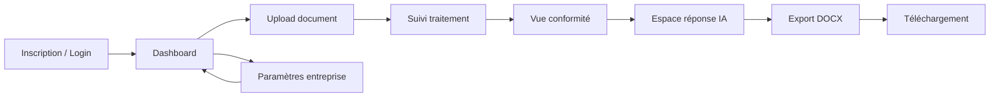
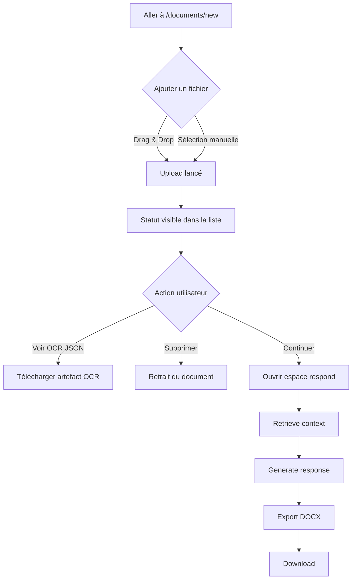
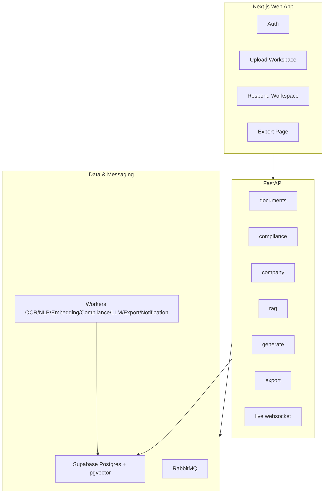

# mi-parcours — Description produit P2M-TAI

> Basé sur la lecture de `planTender.md` et l’audit du projet complet `P2M-TAI`.

---

## 1) Description produit & expérience utilisateur (sans technique)

### Vision produit
P2M-TAI est une plateforme qui aide une équipe à transformer un dossier d’appel d’offres brut en réponse prête à livrer. L’utilisateur est guidé de bout en bout: dépôt du document, suivi d’analyse, lecture de conformité, génération d’une réponse, puis export final.

### Parcours utilisateur principal

1. **Connexion / inscription**
   - L’utilisateur crée son compte ou se connecte.
   - Il accède ensuite à un espace central (dashboard + navigation).

2. **Dépôt d’un document d’appel d’offres**
   - L’utilisateur ouvre l’espace “Nouveau document”.
   - Il glisse-dépose un fichier ou le sélectionne depuis son appareil.
   - Juste après l’envoi, il voit les informations du document (nom, taille, statut).

3. **Suivi de progression en temps réel**
   - L’utilisateur visualise l’avancement du traitement étape par étape.
   - Il voit l’état global du pipeline et peut rafraîchir les données.
   - Il peut aussi supprimer un document ou télécharger le résultat OCR JSON.

4. **Lecture de conformité (aide à la décision)**
   - L’utilisateur consulte un score d’éligibilité et une recommandation.
   - Il voit les exigences respectées/non respectées pour décider rapidement s’il faut poursuivre.

5. **Espace de génération de réponse**
   - L’utilisateur pose une demande (ex: générer une réponse complète).
   - Le système propose d’abord les extraits les plus pertinents.
   - L’utilisateur lance ensuite la génération du brouillon et vérifie les citations.

6. **Export & téléchargement**
   - L’utilisateur exporte la réponse en document final.
   - Il récupère un lien de téléchargement prêt à l’usage.

7. **Paramètres entreprise**
   - L’utilisateur peut maintenir les informations de profil entreprise.
   - Un espace annexes/coffre documentaire existe (actuellement en version scaffold).

### Graphe — User flow global



### Graphe — Détail UX côté utilisateur



---

## 2) Détail technique par fonctionnalité

> Ici on passe en mode technique: stack utilisée + implémentation réelle observée.

### 2.1 Authentification
- **Tech**: Next.js + Supabase Auth (`@supabase/supabase-js`).
- **Implémentation**:
  - Pages: `/login`, `/register`.
  - Composants: `components/auth/login-form.tsx`, `register-form.tsx`, `sign-out-button.tsx`.
  - Hook session: `hooks/use-auth.ts` (`getSession` + `onAuthStateChange`).
  - Redirection dashboard si non connecté: `app/dashboard/page.tsx`.

### 2.2 Upload de documents + listing + suppression
- **Tech**: UI Next.js client + API FastAPI + persistance Supabase.
- **Implémentation**:
  - UI principale: `components/upload/document-upload-dropzone.tsx`.
  - Upload: `POST /api/v1/documents`.
  - Liste: `GET /api/v1/documents`.
  - Suppression: `DELETE /api/v1/documents/{id}`.
  - Contraintes: PDF/DOC/DOCX/TXT, max 20MB.

### 2.3 Statuts live et monitoring utilisateur
- **Tech**: WebSocket + polling contrôlé par visibilité onglet.
- **Implémentation**:
  - WS backend: `/api/v1/live/documents` (`routers/live.py`).
  - Frontend écoute les updates `documents.updated` et met la liste à jour.
  - Endpoint santé messaging: `GET /api/v1/system/messaging`.

### 2.4 Pipeline évènementiel Track A
- **Tech**: RabbitMQ (exchange topic `p2m.events`) + workers Python.
- **Implémentation**:
  - Évènements: `document_uploaded -> ocr_complete -> nlp_completed -> embedding_complete -> compliance_completed`.
  - Déclarés dans `core/pipeline_events.py`.
  - Topology + consume/publish dans `core/rabbitmq.py`.

### 2.5 OCR
- **Tech**: Mistral OCR (`mistralai`).
- **Implémentation**:
  - Worker: `services/ocr/worker.py`.
  - Client: `services/ocr/client.py`.
  - Lit le fichier stocké localement, lance OCR, sauvegarde artefact JSON, publie `ocr_complete`.

### 2.6 NLP (langue, chunking, traduction, métadonnées)
- **Tech**: `langdetect`, `chonkie`, `deep-translator`, logique rules + Groq optionnel.
- **Implémentation**:
  - Worker: `services/nlp/worker.py`.
  - Détection langue: `services/nlp/chunking.py`.
  - Chunking: `SentenceChunker` (fallback regex si besoin).
  - Traduction FR->EN: `services/nlp/translation.py`.
  - Métadonnées: `services/nlp/metadata.py` (deadline, budget, country, category).

### 2.7 Embeddings et index vectoriel
- **Tech**: LangChain HuggingFace endpoint embeddings + pgvector Supabase.
- **Implémentation**:
  - Worker: `services/embedding/worker.py`.
  - Client embeddings: `services/embedding/hf_client.py`.
  - Écriture des vecteurs dans `chunks.embedding`.
  - Passage à `embedding_complete` après persistance.

### 2.8 Conformité / scoring
- **Tech**: moteur de règles Python + tables Supabase.
- **Implémentation**:
  - Moteur: `services/compliance/engine.py`.
  - Extrait entités document, compare au profil entreprise, calcule score pondéré.
  - Persistance: `requirements`, `compliance_reports`.

### 2.9 Notifications
- **Tech**: SendGrid.
- **Implémentation**:
  - Worker: `services/notification/worker.py`.
  - Consomme `compliance_completed`, envoie email "High Match", enregistre état `pending/sent/failed`.

### 2.10 RAG retrieval
- **Tech**: FastAPI + recherche vectorielle pgvector (RPC `match_chunks`) avec fallback.
- **Implémentation**:
  - Endpoint: `POST /api/v1/rag/query` (`routers/rag.py`).
  - Recherche: `services/rag/client.py`.
  - Retourne chunks pertinents + score similarité.

### 2.11 Génération de réponse IA
- **Tech**: Groq via LangChain (`langchain-groq`).
- **Implémentation**:
  - Endpoint: `POST /api/v1/generate/response` (`routers/generate.py`).
  - Worker/service: `services/llm/worker.py`, `services/llm/client.py`.
  - Prompting multilingue FR/AR/EN, génération + extraction de citations.
  - Sauvegarde en table `responses`.

### 2.12 Export final
- **Tech**: `python-docx` + endpoint téléchargement FastAPI.
- **Implémentation**:
  - Endpoint export: `POST /api/v1/documents/{id}/export`.
  - Endpoint download: `GET /api/v1/exports/{id}/download`.
  - Service: `services/export/worker.py`.
  - Génère un DOCX structuré avec contenu + citations.

### 2.13 Base de données et schéma
- **Tech**: Supabase Postgres + migrations SQL + extension `vector`.
- **Implémentation**:
  - Migrations: `infra/supabase/migrations/*.sql`.
  - Fondations: `tenants`, `users`.
  - Track A: `documents`, `chunks`, `requirements`, `compliance_reports`, `company_profiles`, `annexes`, `notifications`.
  - Track B: `responses`, `exports`.
  - Fonction SQL vectorielle: `match_chunks` (migration `0010_*`).

---

## 3) Graphes techniques (pipeline et génération)

### 3.1 Pipeline Track A (ingestion -> conformité)

```mermaid
flowchart LR
    A[Upload API] --> B[document_uploaded]
    B --> C[OCR Worker]
    C --> D[ocr_complete]
    D --> E[NLP Worker]
    E --> F[nlp_completed]
    F --> G[Embedding Worker]
    G --> H[embedding_complete]
    H --> I[Compliance Engine]
    I --> J[compliance_completed]
    J --> K[Notification Worker]
```



### 3.2 Pipeline Track B (RAG -> LLM -> Export)

```mermaid
flowchart LR
    A[Query utilisateur] --> B[RAG /rag/query]
    B --> C[Chunks pertinents]
    C --> D[Generate /generate/response]
    D --> E[Réponse + citations]
    E --> F[Export /documents/{id}/export]
    F --> G[Download /exports/{id}/download]
```

### 3.3 Vue d’ensemble des modules



---

## 4) État actuel observé (important)

- Le flux **upload + suivi + pipeline backend + respond + export DOCX** est présent dans le code.
- Certaines pages Track A restent en **scaffold UI** (`/documents/[id]`, `/documents/[id]/compliance`, `/settings/company`, `/settings/annexes`) mais les routes/API associées existent côté backend.
- Le contrat Track A/Track B par table `chunks` est bien visible dans l’implémentation et les migrations.
