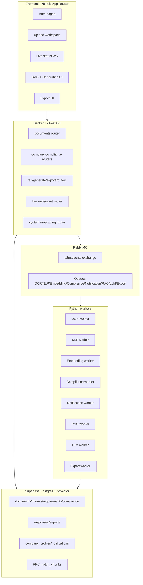
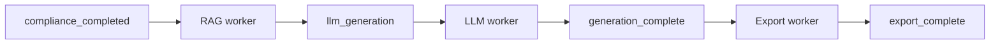
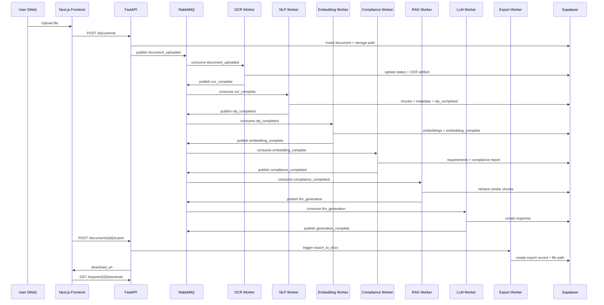

# mi-parcours — Présentation technique complète du projet P2M-TAI

> Objectif de ce document : présenter **la partie technique complète** du projet, expliquer **comment chaque service atteint son objectif**, et détailler **les technologies/dépendances utilisées** sur toute la chaîne.

---

## 1) Contexte et objectif système

P2M-TAI est une plateforme d’automatisation de réponse aux appels d’offres construite en architecture **feature split verticale** :

- **Track A** : ingestion documentaire + analyse + conformité
- **Track B** : retrieval contextuel (RAG) + génération de réponse + export

Le point d’intégration principal est la table **`chunks`** :
- Track A écrit les chunks + embeddings
- Track B lit ces chunks pour la recherche sémantique et la génération

---

## 2) Architecture globale (technique)

### 2.1 Vue macro



### 2.2 Stack principale

- **Frontend**: Next.js (App Router), React, TypeScript, Tailwind CSS v4, shadcn/ui, lucide-react
- **Backend**: FastAPI (Python 3.11+)
- **DB**: Supabase Postgres + extension `vector` (pgvector)
- **Messaging**: RabbitMQ (plus Redis en infra locale)
- **AI/ML**:
  - OCR: Mistral OCR (`mistralai`)
  - NLP: `langdetect`, `chonkie`, `deep-translator`, règles + Groq optionnel
  - Embeddings: LangChain HuggingFace endpoint (`langchain-huggingface`)
  - LLM generation: Groq via LangChain (`langchain-groq`)
- **Export**: `python-docx`
- **Email**: SendGrid

---

## 3) Monorepo, modules et ownership

## 3.1 Structure

```text
P2M-TAI/
├── apps/web                 # Next.js frontend
├── apps/api                 # FastAPI backend + workers
├── packages/shared-types    # contrats TS partagés
├── packages/ui              # package UI placeholder
├── infra/supabase/migrations
└── infra/docker
```

### 3.2 Ownership fonctionnel

- **Track A** (docs/handoff/track-a.md): upload, document detail/compliance/settings, routers documents/compliance/company, services ocr/nlp/embedding/compliance
- **Track B** (docs/handoff/track-b.md): respond/export pages, routers rag/generate/export, services rag/llm/export

---

## 4) Frontend technique détaillé

## 4.1 Dépendances frontend (`apps/web/package.json`)

- Runtime:
  - `next`, `react`, `react-dom`
  - `@supabase/supabase-js`
  - `shadcn`, `@base-ui/react`
  - `class-variance-authority`, `clsx`, `tailwind-merge`
  - `lucide-react`, `tw-animate-css`
- Dev:
  - `typescript`
  - `tailwindcss`, `@tailwindcss/postcss`, `postcss`
  - `@types/node`, `@types/react`

## 4.2 Configuration frontend

- `next.config.mjs`: `reactStrictMode: true`
- `tsconfig.json`: `strict: true`, alias `@/* -> src/*`, `moduleResolution: Bundler`
- `components.json`: configuration shadcn (`style: base-nova`, `rsc: true`, `iconLibrary: lucide`)
- `globals.css`: design tokens/couleurs/variables thème clair-sombre + Tailwind v4 imports

## 4.3 Auth frontend

- Supabase client: `apps/web/src/lib/supabase/client.ts`
- Hook de session: `hooks/use-auth.ts`
- Pages:
  - `/login` (login form)
  - `/register` (register form)
  - `/dashboard` (guard + signout)

## 4.4 API client frontend

Fichier: `apps/web/src/lib/api/client.ts`

- Base URL: `NEXT_PUBLIC_API_URL` (fallback `http://localhost:8100`)
- Fonctions clés:
  - `uploadDocument`, `fetchDocuments`, `deleteDocument`
  - `fetchDocumentOcrArtifact`
  - `fetchMessagingStatus`
  - `ragQuery`, `generateTenderResponse`, `exportGeneratedResponse`
- WS URL helper: `getApiWebSocketBaseUrl()`
- Mapping visuel statut pipeline: `getStatusProgress()`

## 4.5 Pages et composants user-facing

- Upload: `/documents/new` + `DocumentUploadDropzone`
- Respond: `/documents/[id]/respond` (retrieve context + generate + export docx)
- Export: `/documents/[id]/export`
- Live documents: websocket `/api/v1/live/documents`
- Pages scaffold Track A visibles:
  - `/documents/[id]`
  - `/documents/[id]/compliance`
  - `/settings/company`
  - `/settings/annexes`

---

## 5) Backend technique détaillé

## 5.1 Dépendances backend (`apps/api/pyproject.toml`)

- API & core: `fastapi`, `uvicorn`, `pydantic`, `python-dotenv`, `python-multipart`
- Data: `supabase`
- Messaging: `pika` (RabbitMQ)
- OCR/NLP/AI:
  - `mistralai`
  - `langdetect`
  - `spacy`
  - `chonkie`
  - `deep-translator`
  - `langchain`, `langchain-groq`, `langchain-huggingface`, `groq`
- Export: `python-docx`
- Notifications: `sendgrid`
- Utilitaires HTTP: `requests`

## 5.2 Initialisation API

Fichier: `apps/api/src/app.py`

- App FastAPI + CORS (`API_ALLOWED_ORIGINS`)
- Routes enregistrées dynamiquement depuis:
  - `documents`, `compliance`, `company`, `rag`, `generate`, `export`, `system`
- Endpoint santé: `GET /health`
- Bootstrap topology RabbitMQ au démarrage (`ensure_topology()`)
- WebSocket route registration (`register_websocket_routes`)

## 5.3 Routeurs backend et responsabilités

- `documents.py`
  - upload, list, detail, delete, status, requirements, ocr-artifact
  - validation type/poids des fichiers
- `compliance.py`
  - exposition du rapport conformité + requirements
- `company.py`
  - profile get/update, annexes stubs
- `rag.py`
  - recherche chunks similaires via embeddings
- `generate.py`
  - génération réponse, get/patch response, list responses
  - gating par status document
- `export.py`
  - export DOCX + téléchargement
- `system.py`
  - état RabbitMQ + topology
- `live.py`
  - websocket updates documents

---

## 6) Couche core backend

## 6.1 `document_repository.py`

Rôle: couche d’accès données centralisée pour toutes les entités.

Gère:
- `documents`, `chunks`, `requirements`, `compliance_reports`
- `company_profiles`, `notifications`
- `responses`, `exports`

Fonctions clés:
- CRUD documents + transitions de statut (`update_document_status_if_current`)
- remplacement chunks + embeddings
- persistance requirements/compliance
- persistance/lecture réponses & exports
- idempotence notification (`get_notification_by_event`)

## 6.2 `rabbitmq.py`

Rôle: abstraction messaging complète.

Inclut:
- configuration `RabbitMqSettings`
- `publish_event`, `consume`, `ensure_topology`, `can_connect`
- déclaration exchange/queues/bindings
- stratégie reconnexion, gestion erreurs auth/connection, ack/nack sûrs

## 6.3 `pipeline_events.py`

Rôle: constantes d’événements + enveloppe normalisée.

- Noms events (upload -> export)
- Noms queues par étape
- `build_event()` avec `event_id`, `occurred_at`, `payload`

## 6.4 `file_storage.py`

Rôle: stockage local de fichiers/artefacts.

- documents uploadés (`storage/documents`)
- artefacts OCR JSON (`storage/artifacts/{document_id}`)
- artefacts response JSON (`storage/responses/{response_id}`)
- fichiers export (`storage/exports/{export_id}.docx`)

---

## 7) Pipeline Track A — services et dépendances

### 7.1 Graphe pipeline Track A


### 7.2 Service ingestion (`services/ingestion/worker.py`)

- **Objectif**: persister document uploadé + démarrer pipeline
- **Entrée**: appel route `POST /documents`
- **Dépendances**:
  - `document_repository` (create + status)
  - `file_storage.save_uploaded_file`
  - `rabbitmq.publish_event`
  - `pipeline_events.EVENT_DOCUMENT_UPLOADED`
- **Sortie**: event `document_uploaded`, status initial `ocr_processing`

### 7.3 Service OCR (`services/ocr/worker.py`)

- **Objectif**: extraire texte structuré depuis document source
- **Entrée**: event `document_uploaded`
- **Dépendances**:
  - `mistralai` client (`services/ocr/client.py`)
  - `file_storage.save_ocr_artifact`
  - `document_repository.update_document_status`
  - `rabbitmq.publish_event`
- **Sortie**: event `ocr_complete` + artefact JSON OCR

### 7.4 Service NLP (`services/nlp/worker.py`)

- **Objectif**: transformer texte OCR en chunks analytiques exploitables
- **Entrée**: event `ocr_complete`
- **Dépendances**:
  - `langdetect` (language detection)
  - `chonkie` (sentence chunking, fallback regex)
  - `deep-translator` (FR->EN)
  - metadata rules + optional Groq in `metadata.py`
  - `document_repository.replace_document_chunks`
- **Constantes**:
  - `MAX_CHUNK_TOKENS=300`
  - `METADATA_TOP_CHUNKS=6`
- **Sortie**: `nlp_completed`, chunk_count + metadata document

### 7.5 Service Embedding (`services/embedding/worker.py`)

- **Objectif**: vectoriser les chunks et les stocker pour recherche sémantique
- **Entrée**: event `nlp_completed`
- **Dépendances**:
  - `langchain_huggingface.HuggingFaceEndpointEmbeddings`
  - HF token (`HF_TOKEN`)
  - `document_repository.save_chunk_embeddings`
- **Constantes**:
  - `EMBEDDING_BATCH_SIZE=32`
  - `EMBEDDING_DIMENSION=1024`
  - modèle défaut `BAAI/bge-m3`
- **Sortie**: `embedding_complete` (ou `embedding_failed`)

### 7.6 Service Compliance (`services/compliance/engine.py`)

- **Objectif**: calculer éligibilité et recommandation par règles métier
- **Entrée**: event `embedding_complete`
- **Dépendances**:
  - extraction entités regex (reference, deadline, budget, etc.)
  - comparaison avec `company_profiles`
  - persistance `requirements` + `compliance_reports`
  - publish `compliance_completed`
- **Sortie**: score, recommendation, payload détaillé report

### 7.7 Service Notification (`services/notification/worker.py`)

- **Objectif**: notifier résultat conformité (high match)
- **Entrée**: event `compliance_completed`
- **Dépendances**:
  - `sendgrid`
  - `document_repository.create_notification/update_notification_status`
  - idempotence par index unique `(event_id, template_name, recipient_email)`
- **Sortie**: email envoyé + statut `sent/failed`

---

## 8) Pipeline Track B — services et dépendances

### 8.1 Graphe pipeline Track B



### 8.2 Service RAG (`services/rag/worker.py` + `services/rag/client.py`)

- **Objectif**: récupérer le meilleur contexte document pour génération
- **Entrée**: event `compliance_completed` (automatique) ou endpoint `/rag/query` (manuel)
- **Dépendances**:
  - `embedding.hf_client.request_embeddings` (embedding query)
  - RPC Supabase `match_chunks` (vector similarity)
  - fallback cosine similarity si RPC indisponible
  - `rabbitmq.publish_event(EVENT_LLM_GENERATION)`
- **Sortie**: chunks pertinents + event `llm_generation`

### 8.3 Service LLM (`services/llm/worker.py` + `services/llm/client.py`)

- **Objectif**: générer une réponse d’appel d’offres structurée et citée
- **Entrée**: event `llm_generation` ou endpoint `/generate/response`
- **Dépendances**:
  - `langchain_groq.ChatGroq`
  - `GROQ_API_KEY`
  - prompt system multilingue FR/AR/EN
  - extraction citations `[Excerpt X]`
  - persistance table `responses`
- **Sortie**: response stockée + event `generation_complete`

### 8.4 Service Export (`services/export/worker.py`)

- **Objectif**: produire document livrable (DOCX)
- **Entrée**: endpoint `/documents/{id}/export` ou event `generation_complete`
- **Dépendances**:
  - `python-docx`
  - `file_storage.get_export_storage_path`
  - persistance table `exports` + status
  - endpoint download `FileResponse`
- **Sortie**: fichier DOCX + `download_url`

---

## 9) Schéma DB et migrations (détail)

## 9.1 Migrations clés

- `0001_shared_foundation.sql`
  - extension `vector`
  - tables `tenants`, `users`
- `0002_track_a.sql`
  - `documents`, `chunks`, `requirements`, `compliance_reports`, `company_profiles`, `annexes`
- `0003_track_b.sql`
  - `responses`, `exports`
- `0004_track_a_documents_metadata.sql`
  - `documents.size_bytes`, `documents.content_type`
- `0005_track_a_nlp_columns.sql`
  - `documents.chunk_count`, `documents.metadata`
- `0006_track_a_embedding_dimension.sql`
  - `chunks.embedding` en `vector(1024)`
- `0007_track_a_requirements_fields.sql`
  - enrichissement requirements + compliance report + indexes uniques
- `0008_track_a_notifications.sql`
  - table `notifications`
- `0009_track_a_notification_idempotency.sql`
  - `event_id` + index unique idempotence
- `0010_track_b_exports_columns_and_match_chunks.sql`
  - `exports.status`, `exports.tenant_id`, indexes
  - fonction RPC `match_chunks`
- `0011_track_a_chunk_metadata.sql`
  - colonne `chunks.metadata`
- `0012_track_a_chunk_metadata_not_null.sql`
  - metadata non null + default `{}`

## 9.2 Entités métier clés

- **Track A**: documents, chunks, requirements, compliance_reports, company_profiles, annexes, notifications
- **Track B**: responses, exports
- **Shared**: tenants, users

---

## 10) API contract consolidé

## 10.1 Track A

- `POST /api/v1/documents`
- `GET /api/v1/documents`
- `GET /api/v1/documents/{id}`
- `DELETE /api/v1/documents/{id}`
- `GET /api/v1/documents/{id}/status`
- `GET /api/v1/documents/{id}/requirements`
- `GET /api/v1/documents/{id}/compliance`
- `GET /api/v1/documents/{id}/ocr-artifact`
- `GET|PUT /api/v1/company/profile`
- `GET|POST /api/v1/company/annexes`
- `GET /api/v1/system/messaging`
- `WS /api/v1/live/documents`

## 10.2 Track B

- `POST /api/v1/rag/query`
- `POST /api/v1/generate/response`
- `GET /api/v1/responses/{id}`
- `PATCH /api/v1/responses/{id}`
- `GET /api/v1/documents/{id}/responses`
- `POST /api/v1/documents/{id}/export`
- `GET /api/v1/exports/{id}/download`
- `GET /api/v1/documents/{id}/exports`

---

## 11) Variables d’environnement et dépendances d’exécution

## 11.1 Frontend (`apps/web/.env.example`)

- `NEXT_PUBLIC_SUPABASE_URL`
- `NEXT_PUBLIC_SUPABASE_ANON_KEY`
- `NEXT_PUBLIC_API_URL`

## 11.2 Backend (`apps/api/.env.example`)

- Supabase:
  - `SUPABASE_URL`
  - `SUPABASE_ANON_KEY`
  - `SUPABASE_SERVICE_ROLE_KEY`
- API:
  - `API_ALLOWED_ORIGINS`
  - `WEB_BASE_URL`
- Messaging:
  - `RABBITMQ_URL`
- AI services:
  - `MISTRAL_API_KEY`
  - `GROQ_API_KEY`
  - `LANGCHAIN_GROQ_METADATA_MODEL`
  - `HF_TOKEN`
  - `LANGCHAIN_EMBEDDING_MODEL`
- Notifications:
  - `SENDGRID_API_KEY`
  - `SENDGRID_FROM_EMAIL`
  - `NOTIFICATION_RECIPIENT_EMAIL`

---

## 12) Infra locale (Docker)

## 12.1 Messaging stack

Fichier: `infra/docker/messaging/docker-compose.yml`

- RabbitMQ management image
  - ports: `5672` (broker), `15672` (UI)
  - credentials par défaut: `admin/admin`
- Redis
  - port exposé local: `6400`

## 12.2 Supabase local helper

Fichier: `infra/docker/supabase-local/docker-compose.yml`

- Postgres image Supabase
- port `54322 -> 5432`

---

## 13) Séquence détaillée end-to-end



---

## 14) Shared contracts & packages

- `packages/shared-types/src/index.ts`
  - types: `Chunk`, `RagQueryRequest/Response`, `ResponseRecord`, `ExportRequest/Record`, etc.
- `packages/ui`
  - actuellement placeholder (`uiPlaceholder`) pour future mutualisation UI

---

## 15) État réel observé (important pour présentation)

1. **Ce qui est réellement actif dans le code**
   - Upload + statut live + pipeline workers + RAG/generation/export DOCX
   - Architecture event-driven complète implémentée

2. **Ce qui est partiellement scaffoldé côté UI**
   - `documents/[id]`, `documents/[id]/compliance`, `settings/company`, `settings/annexes`
   - Les APIs backend associées existent, mais certaines pages frontend restent minimales

3. **Cohérence Track A -> Track B**
   - Pipeline DB+events cohérent
   - Intégration via `chunks` + RPC `match_chunks` en place

---

## 16) Résumé technique exécutif

P2M-TAI combine une UI Next.js orientée productivité et un backend FastAPI event-driven. Track A industrialise la transformation document brut -> représentation structurée vectorisée + conformité. Track B exploite cette base pour retrieval contextuel, génération IA multilingue citée, et export documentaire. La plateforme s’appuie sur Supabase/pgvector pour la donnée, RabbitMQ pour l’orchestration asynchrone, et des services spécialisés (Mistral, Groq, HuggingFace, SendGrid) pour les capacités IA et communication.

---

## 17) Commandes de build/run/check (opérationnel)

## 17.1 Scripts npm racine

`package.json` (root):

- `npm run dev:web` -> lance le frontend (`apps/web`)
- `npm run build:web` -> build production web
- `npm run typecheck:web` -> vérification TypeScript web

## 17.2 Scripts npm web

`apps/web/package.json`:

- `npm run dev`
- `npm run build`
- `npm run start`
- `npm run typecheck`

## 17.3 Commandes backend/workers

- API FastAPI:
  - `.venv311/Scripts/python -m uvicorn apps.api.src.main:app --reload --host 127.0.0.1 --port 8100`
- OCR worker:
  - `.venv311/Scripts/python -m apps.api.src.services.ocr.run_worker`
- NLP worker:
  - `.venv311/Scripts/python -m apps.api.src.services.nlp.run_worker`
- Embedding worker:
  - `.venv311/Scripts/python -m apps.api.src.services.embedding.run_worker`
- Compliance worker:
  - `.venv311/Scripts/python -m apps.api.src.services.compliance.run_worker`
- Notification worker:
  - `.venv311/Scripts/python -m apps.api.src.services.notification.run_worker`
- RAG worker:
  - `.venv311/Scripts/python -m apps.api.src.services.rag.run_worker`
- LLM worker:
  - `.venv311/Scripts/python -m apps.api.src.services.llm.run_worker`
- Export worker:
  - `.venv311/Scripts/python -m apps.api.src.services.export.run_worker`

---

## 18) Topologie messaging exacte

Définie dans `apps/api/src/core/pipeline_events.py` et `rabbitmq.py`.

- **Exchange**: `p2m.events`
- **Type**: `topic`

### 18.1 Queues

- `track_a.ocr.queue`
- `track_a.nlp.queue`
- `track_a.embedding.queue`
- `track_a.compliance.queue`
- `track_a.notification.queue`
- `track_b.rag.queue`
- `track_b.llm_generation.queue`
- `track_b.export.queue`

### 18.2 Events

- `document_uploaded`
- `ocr_complete`
- `nlp_completed`
- `embedding_complete`
- `compliance_completed`
- `llm_generation`
- `generation_complete`
- `export_complete`

---

## 19) États métier document/réponse/export

## 19.1 États document observés

- `uploaded`
- `ocr_processing`
- `ocr_complete`
- `nlp_processing`
- `nlp_completed`
- `embedding_processing`
- `embedding_complete`
- `compliance_processing`
- `compliance_completed`
- `generating`
- `generation_complete`
- `generation_failed`
- `ocr_failed`
- `nlp_failed`
- `embedding_failed`

## 19.2 États export

- `processing`
- `completed`

## 19.3 États notification

- `pending`
- `sent`
- `failed`

---

## 20) Contrats de données et payloads clés

## 20.1 Payload upload (API)

- `POST /api/v1/documents`
  - content-type: `multipart/form-data`
  - champ: `file`
  - mime autorisés: PDF/DOC/DOCX/TXT
  - taille max: 20MB

## 20.2 Contrat chunk (shared-types)

`packages/shared-types/src/index.ts`:

- `Chunk`:
  - `id`
  - `document_id`
  - `content`
  - `content_translated`
  - `embedding: number[]`
  - `position`
  - `page_number`

## 20.3 Contrat RAG

- `RagQueryRequest`: `document_id`, `query`, `top_k`
- `RagQueryResponse`: `document_id`, `results`

## 20.4 Contrat génération/export

- `GenerateResponseRequest`: `document_id`, `language`, `instructions?`
- `ResponseRecord`: `id`, `document_id`, `content`, `citations`
- `ExportRequest`: `format`, `response_id`
- `ExportRecord`: `id`, `document_id`, `response_id`, `format`, `file_path`

---

## 21) Fiabilité, sécurité, et garde-fous techniques

## 21.1 Fiabilité pipeline

- Topology RabbitMQ redéclarée automatiquement.
- `consume()` implémente:
  - reconnexion exponentielle
  - gestion erreurs auth/connexion
  - ack/nack sûrs avec callbacks thread-safe
  - prefetch (`basic_qos`) pour limiter in-flight
- transitions de statut conditionnelles (`update_document_status_if_current`) pour réduire race conditions.

## 21.2 Sécurité configuration

- séparation nette des secrets backend (`SUPABASE_SERVICE_ROLE_KEY`, clés API IA, SendGrid).
- frontend ne consomme que variables `NEXT_PUBLIC_*`.
- CORS contrôlé par `API_ALLOWED_ORIGINS`.

## 21.3 Validation d’entrée

- validation stricte upload (type + taille + non vide).
- vérifications de cohérence document/réponse pour export.
- validation `tenant_id` sur endpoints Track B.

---

## 22) Points d’attention / dettes techniques observées

1. **Pages frontend encore scaffoldées** (Track A) malgré API disponible.
2. **Formats export**:
   - shared-types autorise `pdf`
   - route `export.py` accepte actuellement seulement `docx`.
3. **Annexes**:
   - endpoints présents mais logique métier encore minimale (`items: []`, `status: created`).
4. **Package UI partagé** encore placeholder (`@p2m/ui`).

Ces points n’empêchent pas le flux principal, mais sont importants à présenter comme backlog technique.
